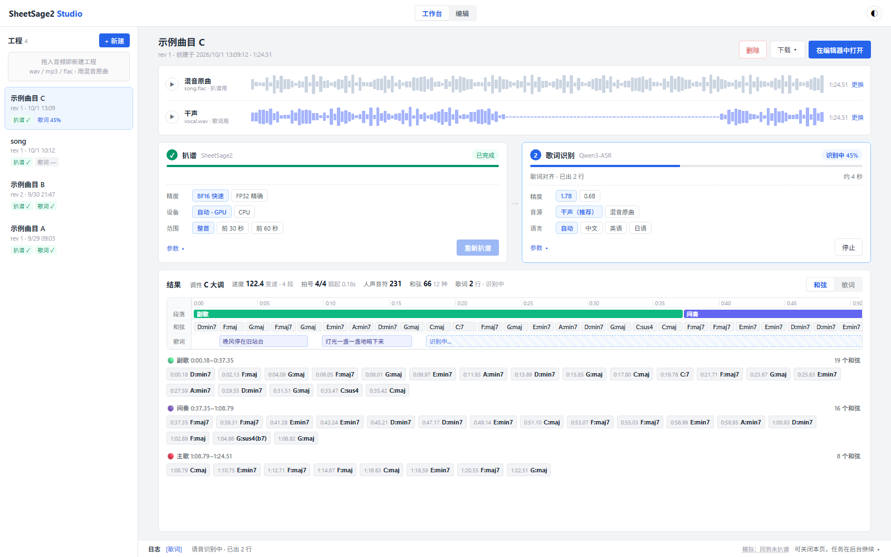

# SheetSage2 Studio

一首歌丢进去 → 自动扒出**旋律 / 和弦 / 段落 / 速度** → AI 识别**歌词并按字挂到音符上** → 导成 **Synthesizer V Studio 工程**（带变速与歌词）或 MIDI。全在本机跑，不传云端。



## 它能做什么

| 功能 | 说明 |
|---|---|
| **扒谱** | 从 wav / mp3 / flac 里取出人声旋律、乐器、和弦、段落、BPM、拍号与调性 |
| **歌词识别** | 用 Qwen3-ASR + 逐字对齐拿到每个字的时间，再按字挂到对应音符上 |
| **结果看得见** | 卷帘里画小节线 / 段落 / 和弦 / 人声音符 / 歌词行，可以边听边对 |
| **导出** | SVP 工程（人声 / 乐器 / 和弦任选，进 SynthV 直接唱）、整包 zip、单个产物 |
| **一个工程 = 一个文件夹** | `output/<歌名>/`，重启不丢，命令行跑过的也能在侧栏里看 |

**已知限制**：原型里的「编辑」页还没做；日语**不支持**转写成罗马音（模型能力限制）；模型权重是 **CC BY-NC 4.0（非商业）**，商用前请另行确认授权。

## 装上、跑起来

### 方式一：内测包（推荐，不用装 Python / ffmpeg）

1. 解压到**不含中文的路径**，留出 20 GB 空间；
2. 双击 **`webui.bat`**（首次会自动建环境、下依赖与模型，可断点续传）；
3. 浏览器会自动打开 <http://127.0.0.1:8000>，把音频拖进去就行。

首次运行要联网下 **torch 约 1.8 GB + 模型最小集约 4.3 GB**（1.7B 歌词模型可选，+4.5 GB，随时 `setup.bat --with-1.7b` 补；日语歌才需要的 Qwen 对齐器 `--with-ja`）。逐字对齐用的 TIFA 只有 40M，已经随包带，中/粤/英不用另外下对齐器。只下过一次，之后离线可用；下载/安装没跑完就再双击一次，已完成的部分会跳过。详见 [`README-internal-test.md`](README-internal-test.md)。

### 方式二：从源码（已经会 Python 的人）

```powershell
# 一次性：建 .venv（Python 3.12）+ 装依赖 + 构建前端（细节与版本矩阵见 docs/开发指南.md）
uv venv --python 3.12 .venv
uv pip install --python .\.venv\Scripts\python.exe -e ".[web,svp]" "transformers==4.57.6" qwen-asr
cd web; npm install; npm run build; cd ..

# 之后每次：双击 webui.bat，或者
.\.venv\Scripts\python.exe -m sheetsage2_webui.webui
```

### 机器要求

| 项 | 能用 | 舒服 |
|---|---|---|
| 系统 | Windows 10/11 64 位 | — |
| 显卡 | 核显 / CPU（一首歌 30~90 分钟） | NVIDIA 8 GB 显存（几分钟） |
| 内存 | 16 GB | 32 GB |
| 磁盘 | 20 GB 空闲 | 40 GB+（原音频与产物都留在本地） |
| 网络 | 只有首次安装需要 | — |

4 GB 显存也能跑，启动时选「4G 特供」模式即可（参数与显存预算由服务端定好）。

## 一次完整的用法

1. **拖入音频** —— 支持 wav / mp3 / flac 等；一次拖两个文件时第二个会当成"干声"（人声轨）；
2. **看参数** —— 默认值通常就是最好的，不用改；
3. **点「开始扒谱」** —— 阶段卡上会写「⏱ 预计 2~4 分钟」，跑完能看卷帘；
4. **点「开始识别歌词」** —— 或者一开始就点「⏵ 自动提取」，扒谱和歌词一条龙；
5. **点「下载 SVP」** —— 勾上要装进 SynthV 的内容，拖进 SynthV 就能唱；也可以下整包 zip。

> 想重跑就再点一次「重新扒谱」/「重新识别」；改了参数会让对应的旧结果作废，避免你下载到上一版。

## 常见问题

| 现象 | 说明 |
|---|---|
| 双击 `webui.bat` 好像没反应 | 只会允许一个服务在跑；第二个会直接打开已经在运行的那个页面 |
| 8000 端口被占用 | 会自动换端口，并在窗口里写明"被谁占了" |
| 界面显示「服务已停止」 | 后台窗口被关掉或崩了；重新双击 `webui.bat`，再刷新页面 |
| 报错了看不懂 | 横条上的中文是**人话 + 下一步**，技术原文折叠在「详情」；点顶栏「诊断包」，把压缩包发给任意 AI 就能让它帮你看 |
| 误点了删除 | 进「回收站」，7 天内可一键恢复 |
| 换电脑 / 重装系统 | 顶栏「备份」导出全部工程（含原音频），新机器上「导入备份」 |
| 跑得特别慢 | 没检测到显卡时会自动退 CPU，横幅会说明；阶段卡会显示「预计还需…」 |
| 歌词识别不出来 / 结果很怪 | 用**含人声的完整混音**，或单独传干净的人声干声；纯伴奏、纯静音会被拦下 |
| 磁盘满了 | 顶栏会提示剩余空间；工程头「清理缓存」能删掉可重算的部件 |

## 文档

面向访客看到这里就够了。想深入哪一块，看对应的文档：

| 想了解 | 看这份 |
|---|---|
| 怎么从源码搭环境、跑验证、改前端 | [`docs/开发指南.md`](docs/开发指南.md) |
| 待办、现状、下一步怎么接 | [`docs/交接-下一次对话.md`](docs/交接-下一次对话.md) |
| WebUI 的实现规格（API、状态机、SSE） | [`docs/WebUI规格.md`](docs/WebUI规格.md) |
| WebUI 的问题与改进流水账 | [`docs/WebUI问题清单.md`](docs/WebUI问题清单.md) |
| 异常路径的保障措施评估（丢数据 / 卡死 / 报错） | [`docs/健壮性保障评估.md`](docs/健壮性保障评估.md) |
| 导出 SVP 的选型与实测 | [`docs/SVP导出调研.md`](docs/SVP导出调研.md) |
| BPM / 量化 / 八度校正的实现规格 | [`docs/BPM算法规格.md`](docs/BPM算法规格.md)、[`docs/音符量化规格.md`](docs/音符量化规格.md)、[`docs/八度校正规格.md`](docs/八度校正规格.md) |
| 模型接口、产物与全部踩坑 | [`docs/SheetSage2-集成调研.md`](docs/SheetSage2-集成调研.md) |
| 打包与首次运行下载 | [`docs/打包分发待办.md`](docs/打包分发待办.md) |

## 许可

- 模型权重 [m-a-p/SheetSage2](https://huggingface.co/m-a-p/SheetSage2) 是 **CC BY-NC 4.0（非商业）**；
- 第三方归属与移植代码的许可义务见 [`NOTICE`](NOTICE)。
