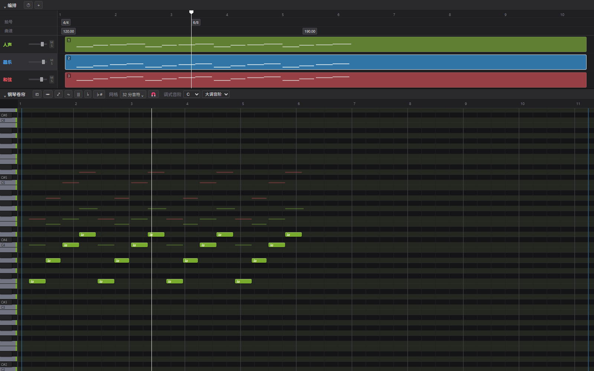

# SheetSage2 WebUI

把一段歌声音频，转成可编辑的工程文件：扒谱 + 歌词识别 + SVP 导出。对接 [m-a-p/SheetSage2](https://huggingface.co/m-a-p/SheetSage2) 音乐理解模型，自带本地 WebUI（Vue 3 + Vite + FastAPI），全程离线，音频不出本机。

## 界面预览


左侧是工程列表与音频轨（原唱 / 干声），中间是「扒谱」「歌词识别」两个阶段卡片与参数面板；下方钢琴卷帘按小节显示和弦与歌词，结果卡片给出每个和弦段落的音符数与和弦走向。



编辑页的钢琴卷帘：人声 / 器乐 / 和弦三条轨道加小节线，顶部可切拍号、调式与量化粒度。

> 截图为界面演示，画面中的曲名与内容均为虚构示例。

## 解决了什么问题

学术模型的输出直接拿去用是不够的。`beat.lab` 的时间戳只有 0.01s 精度，104 BPM 的真拍长 0.576923s 会被存成 0.58s，用朴素中位间隔法读出来是 103.45——10 首歌里最大的偏差到了 75 读成 107。这个项目做的就是**把模型输出变成能交付给人用的结果**：时间对齐怎么算、速度不可靠时怎么报警、精度该报几位、不可信区段怎么隔离。

## 已验证的结果

10 首真实歌曲全部跑通，完整报告见 [docs/验证报告.md](reports/验证报告.md)（16 项验证明细）。

| 能力 | 状态 |
|---|---|
| 全曲转写（滑窗 + 重叠前缀） | ✅ 10 首样例全部跑通 |
| 确定性（同片段跑两次） | ✅ 7 个产物哈希完全一致 |
| 离线加载 / CPU 退让 / 一致性 | ✅ 已验证 |
| 音符时长量化 | ✅ 13 工程 / 26 轨道，最大位移 0.86s → 0.028s |
| 扒谱音高修正 | ✅ 真机 A/B：音符整降一个八度，和弦与拍号不变 |
| 歌词识别（Qwen3-ASR + 逐字对齐） | ✅ 已验证 |
| 导出 SVP（含变速 + 歌词） | ✅ 真机导出 + 往返自洽 |
| WebUI | ✅ 真机端到端 + 49 项 HTTP 测试 + 29 项前端单测 |
| WebUI 的编辑页 | ⏳ 视觉稿已定（见界面预览），交互实现未开始 |

BPM 这个坑值得单说。模型自己的 `Q:1/4=` 用的是首尾两点法，会被结尾散拍拖偏（《相思》模型给 98，网格拟合是 100.001）。所以做了交叉校验——以节拍网格的最小二乘拟合为准，`Q` 值作独立校验，不一致就报警，不静默取舍。

速度分开报几位小数也是量化论证过的：时间戳量化只贡献 ±0.0004 BPM，真实误差来自模型拍点抖动（《不由己》σ=±3.09），所以 σ ≥ 0.05 就只报 1 位小数——不在 MIDI 里暗示不存在的精度。

## 快速开始

```powershell
# 环境（Python 3.12；torch 按 CUDA 版本装对应 cu 轮子）
uv python install 3.12
uv venv --python 3.12 .venv
uv pip install --python .\.venv\Scripts\python.exe -e ".[web,svp]"

# 转写
.\.venv\Scripts\python.exe -m sheetsage2_webui.cli "song.flac" --out-root output

# 起 WebUI（自动构建前端 + 开浏览器）
webui.bat
```

内测包解压即用，无需自装 Python 与 ffmpeg，详见 [docs/打包分发待办.md](docs/打包分发待办.md)。

## 技术栈

Python 3.12 / PyTorch 2.10（CUDA 13）/ transformers 4.57.6 / FastAPI，前端 Vue 3 + Vite + TypeScript。依赖模型：SheetSage2、MERT-v2-FullSong、Qwen3-ASR、Qwen3-ForcedAligner。

## 项目结构

```
src/sheetsage2_webui/
├── engine.py      模型加载 + 转写封装 + 显存不足退让 CPU
├── tempo.py       BPM 鲁棒估计、吸附、恒速化、拍号与弱起、交叉校验
├── timeline.py    秒 → tick 的分段线性映射（时间真源，不依赖 BPM）
├── quantize.py    音符时长量化（整数 DP）
├── octave.py      旋律八度校正
├── asr.py         歌词识别（Qwen3-ASR + 逐字对齐，按区间切片）
├── lyrics.py      把逐字时间戳填到音符上
├── pipeline.py    一键流水线：转写 + 自动裁决 + tick 域工程 + 量化 + 报告
└── webui/         FastAPI 后端（任务状态机 / SSE 进度 / 媒体 / 下载）
docs/              各模块实现规格（BPM / 音符量化 / 八度校正 / WebUI）
scripts/           验证与诊断脚本（verify.py 是可复现证据的来源）
```

## 开发文档

`docs/` 下有各模块的实现规格，包含计算口径、参数表与已知边界，以及调研记录和问题清单：[BPM 算法规格](docs/BPM算法规格.md) · [音符量化规格](docs/音符量化规格.md) · [八度校正规格](docs/八度校正规格.md) · [WebUI 规格](docs/WebUI规格.md) · [WebUI 问题清单](docs/WebUI问题清单.md) · [SheetSage2 集成调研](docs/SheetSage2-集成调研.md)

## 说明

模型权重许可是 CC BY-NC 4.0（非商业），商用前需另行确认授权。
